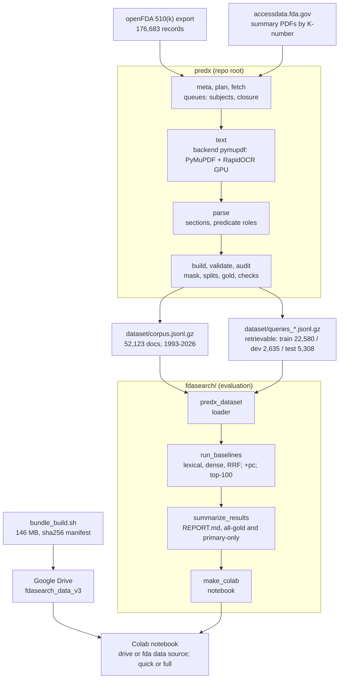

# fdasearch design

2026-11-22 · Keyvan Azami (with Claude Code). Living copy: https://claude.ai/artifact/A4s1wKE1N661PFdsZhALsB

## Goal

Measure how well untuned search methods solve 510(k) predicate retrieval on the dataset built by the team's `predx` pipeline. Given a new device's Indications for Use and Device Description, a method must rank the 52,123 earlier clearances in the corpus so that the predicates its 510(k) summary cites come first. These numbers are the zero-shot reference for the fine-tuned retriever.

- **Query**: one 510(k) subject cleared in 2024 (dev) or 2025 to 2026 (test). Text = Indications for Use + Device Description, with every K-number and the names of its cited predicates masked (`mask_level: standard`). The device name is not part of the query.
- **Candidates**: every corpus device cleared strictly before the subject's decision date (`n_candidates`); optionally only those sharing its product code (`+pc`).
- **Gold**: the K-numbers the subject's summary cites as predicates. predx gives each document exactly one **primary** predicate and any number of **additional** predicates; **reference** devices are never gold. Scores are reported twice: over all in-corpus gold (primary + additional) and for the primary predicate alone.
- **Train split**: 22,580 retrievable subjects from 2015 to 2023 with 41,281 (subject, predicate) pairs for fine-tuning; never evaluated on.

All definitions come from predx's `config/default.yaml`. fdasearch's own earlier pipeline (v1, v2) is retired; its results are kept in `results_v1/` and `results_v2/` for comparison only.

## System overview

## Data pipeline (predx)

| Stage | What it does | Output under the data root |
| --- | --- | --- |
| `meta` | Normalises the openFDA export | `meta/510k.jsonl.gz` |
| `plan` | Writes K-number queues: `subjects` (substantially-equivalent decisions with a summary, 2015+), `closure` (predicates those subjects cite that are not yet fetched) | `queues/*.txt` |
| `fetch` | Downloads summary PDFs, resumable, with a status log | `pdf/<yy>/K.pdf`, `fetch_status.jsonl` |
| `text` | Page text; OCR for image-only or garbled pages | `text/<yy>/K.txt.gz`, `text_stats.jsonl` |
| `parse` | Finds Indications for Use and Device Description; finds cited K-numbers and assigns roles | `parsed.jsonl.gz` |
| `build` | Keeps documents with both sections, masks leakage, splits by decision year, computes gold and candidate counts | `dataset/` |
| `validate`, `audit` | Invariants (dates, gold in corpus, no self-citation, nothing unmasked) and a PASS/WARN/FAIL report | `reports/audit.md` |

**What fdasearch added to predx.**

- `text.backend: pymupdf` (`predx/pdftext_pymupdf.py`, `config/pymupdf.yaml`): PyMuPDF for the text layer and RapidOCR on the GPU for scanned pages, with the same on-disk format as the poppler + tesseract backend. 13,613 of 55,590 documents needed OCR on at least one page. The recogniser is the English PP-OCRv3 model, because RapidOCR's bundled model drops the spaces between English words and the heading rules need them.
- `mask_k_numbers` now repeats until no K-number is left, which fixes numbers glued together such as `K140833K140833`.
- `fdasearch/scripts/predx_bridge.py` hard-links PDFs that were already downloaded into the predx layout.

**Roles.** A document's primary predicate is, in order of preference: the one labelled primary in the summary (6,809 documents), the first K-number in the predicate section (40,404), or the first other K-number anywhere when no predicate section is found (2,145). 2,765 usable documents cite nothing.

**Coverage.** FDA throttles bursts: the default 4 requests per second returns HTTP 403, a single thread at 0.8 requests per second works. 54,551 PDFs were fetched and 1,152 are not on the FDA server. 52,123 documents are usable; 2,510 were dropped because a section was missing. 87.6% of all cited (subject, predicate) pairs have the predicate in the corpus: 93.9% of test subjects, 92.7% of dev subjects and 91.2% of train subjects have at least one.

**Audit.** 19 of 23 checks pass. The one failing finding: about 76% of descriptions exceed the 256-token input budget in the predx config, so a model fine-tuned at that length would see truncated descriptions. Warnings: pair coverage 87.6% against a 90% target, and approximate token counts because the EmbeddingGemma tokenizer is gated.

## Retrieval baselines and evaluation

`run_baselines.py` scores every dev and test query against the whole corpus with exact (brute-force) search, applies the candidate filter, and writes per-query ranks plus a top-100 list that fusion reuses.

| Family | Methods | How |
| --- | --- | --- |
| Trivial | random, pop | pop ranks same-product-code devices by how often the train pairs cite them, recency as tie-break |
| Lexical | TF-IDF (1-2 grams, cosine), BM25 (bm25s + stemming), LSA (SVD-300 over TF-IDF) | fit on the corpus, no tuning |
| Dense, local | MiniLM-L6, bge-base, e5-base, gte-modernbert, bge-m3, Qwen3-Embedding 0.6B and 4B | sentence-transformers on an RTX 4090, 512-token limit, model-specific query prompts, vectors cached per K-number |
| Dense, Ollama | embeddinggemma, nomic-embed-text | local Ollama server (EmbeddingGemma weights are gated on Hugging Face) |
| Dense, API | gemini-embedding-001 | supported by the script; not run on this build |
| Hybrid | `rrf:a\|b` | reciprocal-rank fusion (k = 60) of two saved top-100 lists |

**Metrics.** Recall@10 (share of a query's in-corpus gold in the top 10), Hit@1, Hit@10, Hit@100, MRR, and Hit@1, Hit@10, MRR for the primary predicate alone. Gold excluded by a filter counts as not retrieved. Every number carries a 95% bootstrap interval over queries (1,000 resamples).

## Results

Test split, 5,308 queries. The primary columns cover the 5,173 queries whose primary predicate is in the corpus.

| Method | Recall@10 % | Hit@1 % | Hit@10 % | Hit@100 % | primary Hit@1 % | primary Hit@10 % |
| --- | --- | --- | --- | --- | --- | --- |
| TF-IDF | 72.6 | 49.6 | 83.1 | 96.6 | 43.9 | 78.8 |
| RRF TF-IDF + EmbeddingGemma | 70.3 | 45.2 | 80.7 | 97.0 | 39.8 | 76.2 |
| RRF TF-IDF + bge-m3 | 70.1 | 45.5 | 80.5 | 96.8 | 39.8 | 76.1 |
| BM25 | 68.4 | 45.0 | 78.5 | 94.7 | 39.4 | 74.1 |
| Qwen3-Embedding-4B | 63.0 | 37.6 | 73.1 | 94.6 | 32.8 | 68.6 |
| bge-m3 | 62.9 | 41.3 | 73.0 | 92.0 | 36.0 | 68.6 |
| Qwen3-Embedding-0.6B | 62.8 | 40.1 | 73.1 | 92.0 | 34.9 | 68.6 |
| EmbeddingGemma-300M | 62.4 | 39.6 | 72.6 | 92.1 | 34.5 | 67.5 |
| bge-base | 61.6 | 39.7 | 71.8 | 90.9 | 34.4 | 67.0 |
| e5-base | 59.6 | 37.6 | 69.6 | 90.0 | 32.2 | 64.6 |
| gte-modernbert | 58.2 | 38.1 | 68.5 | 87.2 | 33.0 | 63.5 |
| nomic-embed-text | 57.9 | 37.9 | 68.0 | 88.4 | 32.6 | 62.8 |
| LSA | 55.9 | 33.5 | 65.9 | 90.3 | 29.2 | 61.3 |
| MiniLM-L6 | 55.2 | 35.1 | 65.2 | 85.7 | 30.2 | 59.8 |
| Popularity | 20.0 | 5.3 | 25.1 | 68.3 | 4.2 | 20.9 |

- Lexical search wins zero-shot. TF-IDF leads every column except Hit@100; the best untuned embedder is 9.6 points behind on Recall@10.
- The untuned embedders are close to each other: seven models sit between 57.9 and 63.0, and the 4B Qwen model does not beat bge-m3 or its own 0.6B version.
- Fusion with TF-IDF does not beat TF-IDF alone on Recall@10 or Hit@1; it only edges it on Hit@100.
- Primary-only Hit@10 is 4 to 5 points lower than any-gold Hit@10 for every method, and the ranking of methods is the same in both views.
- The product-code filter lowers TF-IDF and BM25 (Recall@10 69.2 and 66.3) and makes little difference for the embedders.
- Dev is easier than test for every method, with a similar ranking.
- Hardest large panels for TF-IDF: physical medicine 58, orthopedic 61, dental 62. Recall@10 falls from 86 for queries with fewer than 10 earlier same-code devices to 68 with 200 or more.

The full tables with intervals, the dev split, the `+pc` variants and the per-panel breakdown are in `results/REPORT.md`.

## Reproducibility

**Colab notebook** (`notebooks/fdasearch_510k_baselines.ipynb`, generated by `scripts/make_colab.py`). It clones this repository and runs the same scripts. `DATA_SOURCE = "drive"` reads the bundle; `"fda"` runs the predx stages against FDA (`predx pilot` in quick mode, `run-all` in full). `MODE = "quick"` restricts to one review panel. EmbeddingGemma needs an `HF_TOKEN` Colab secret and Gemini a `GEMINI_API_KEY` secret; both are skipped when absent.

**Data bundle** (`fdasearch_data_v3`, 146 MB, built by `bundle_build.sh`): the predx build, `parsed.jsonl.gz`, `text_stats.jsonl`, `fetch_status.jsonl` and the metadata so `predx build` can be rerun with another mask level, the audit report, the reference metrics, and `manifest.json` with a sha256 per file that the notebook verifies.

## Limitations and next steps

- **Label noise.** On a 100-summary check against gemma4:31b the predx gold set has precision 0.71 and recall 0.95. Over-inclusion is mostly reference devices and the applicant's own prior clearances, so scores are lower bounds and the primary-only view is the cleanest.
- **Fallback primaries.** 2,145 primaries are the first K-number found anywhere in a document with no predicate section. They are the least reliable labels.
- **Coverage.** 12.4% of cited pairs point outside the corpus: no PDF on the FDA server, a statement instead of a summary, or missing sections.
- **Token budget.** 76% of descriptions are longer than 256 tokens; decide the fine-tuning length before training.
- **Gemini** was not run on this build.
- **Notebook.** It has been executed locally against the bundle, not yet inside Colab itself.

Next: fine-tune on the 41,281 train pairs with hard negatives from the TF-IDF top-100, select on dev, and compare against the table above.
